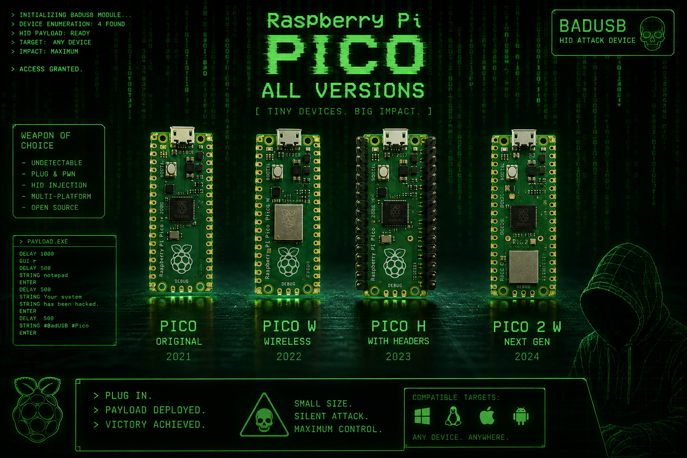

# pico-badusb



**TL;DR:** CircuitPython Rubber Ducky for Pico / Pico W / Pico H / Pico 2 W. Plugs in as a USB keyboard/mouse, runs a `.dd` payload. **27 scripts** for **Windows, macOS, Linux, Android** via `IF_WIN` / `IF_MAC` / `IF_LINUX` / `IF_ANDROID`. US QWERTY. Authorized hosts only — [DISCLAIMER.md](DISCLAIMER.md).

Force OS with `os.txt` or `./tools/deploy.sh <name> win|mac|linux|android`. Without it, Caps Lock LED guesses **Win vs Mac** only (linux/android need a force).

## Setup

1. Flash CircuitPython 10.x UF2 from [circuitpython.org](https://circuitpython.org/downloads).
2. Drop `adafruit_hid` into `CIRCUITPY/lib/` ([bundle](https://github.com/adafruit/Adafruit_CircuitPython_Bundle/releases/latest)).
3. Deploy:

```bash
./tools/deploy.sh rickroll
./tools/deploy.sh rickroll linux
./tools/deploy.sh rickroll android
```

`boot.py` hides CIRCUITPY → later deploys use mpremote.  
**Pico W / 2 W:** AP `PicoBadUSB` / `badusb1234` → `http://192.168.4.1/`

```bash
python3 tools/check_dd.py
```

## Payloads (27)


| payload | OS | notes |
|---------|:--:|-------|
| rickroll |  | YouTube |
| hackertyper |  | hackertyper.com |
| fake_update |  | fakeupdate.io + fullscreen |
| volume_party |  | Settings / MK_VOL |
| mouse_jiggler |  | Mouse move |
| caps_blink |  | Caps toggle |
| notepad_meme |  | Notepad / TextEdit / gedit |
| awareness_banner |  | HID-trust banner |
| speak_warning |  | SAPI / say / spd-say |
| desktop_marker |  | Desktop test file |
| calc_spam |  | Calculator |
| alt_tab_storm |  | App switcher |
| zoom_party |  | Zoom in/out |
| screensaver_poke |  | Lock screen |
| open_security_settings |  | Security / privacy |
| net_info_local |  | ipconfig / ifconfig / ip |
| local_fingerprint |  | Local OS info |
| whoami_desktop |  | whoami + hostname |
| jitter_countdown |  | 3-2-1 |
| snap_dance |  | Snap / tile |
| caps_sync |  | WAIT_FOR_CAPS_* |
| activity_monitor |  | Activity Monitor |
| mac_screenshot |  | Shift-Cmd-3 |
| linux_notify |  | notify-send |
| linux_terminal_banner |  | Terminal banner |
| android_volume |  | MK_VOL spam |
| android_type |  | Type into focus |
